# Lovelace Météo France weather-card - Icones X 4

Complément pour la carte https://github.com/hacf-fr/lovelace-meteofrance-weather-card, proposer par .


- Ajout de nouveaux jeux d'icônes en complément de l'original sur HACF.
- Différentiation des icônes sur certains arguments sur tous les jeux pour la compatibilitée de la carte météo france (Brouillard, Orage pluvieux, Pluie-neige, venteux).
- Icones fixes, améliore la compatibilitée sur Google Nest et moins gourments en ressources.
- Icônes allégées (novembre 2026) : environ 70 % plus légères, sans l'ombre floutée qui faisait recalculer les icônes animées à chaque image, et le brouillard des jeux fixes ne bouge plus. Nettoyage fait avec l'aide d'une IA, rendu comparé au pixel dans Chromium ; la recette est dans `outils/`.
- Nouveau jeu `icons_5` (novembre 2026) : les icônes fixes blanches redessinées pour remplir tout le cadre, plus lisibles en petit. Ce sont aussi les dessins des icônes météo de mes écrans ESPHome / LVGL ([police et doc](https://github.com/Axellum/M5-Tab5-ESPHome-LVGL/tree/main/Tab5/fonts/icone_meteo)).


## Installation:

1/ Ajouter les dossiers avec les nouvelles icones disponible dans le dossier "dist" dans le dossier "/config/www/community/lovelace-meteofrance-weather-card/" de votre Home Assitant par ftp.

2/ Choisissez votre jeux d'icones:

Icônes animées bleus: 
```yaml
/local/community/lovelace-meteofrance-weather-card/icons/ 
```

Icônes fixes bleus: 
```yaml
/local/community/lovelace-meteofrance-weather-card/icons_1/ 
```

Icônes animées blancs: 
```yaml
/local/community/lovelace-meteofrance-weather-card/icons_2/ 
```

Icônes fixe blancs: 
```yaml
/local/community/lovelace-meteofrance-weather-card/icons_3/ 
```

Icônes fixes blancs (variation 01): 
```yaml
/local/community/lovelace-meteofrance-weather-card/icons_4/ 
```

Icônes fixes blancs, agrandis (variation 02): 
```yaml
/local/community/lovelace-meteofrance-weather-card/icons_5/ 
```


### Icones animés bleus:


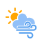


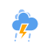

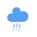


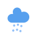



### Icones fixes bleus:


### Icones animées blancs:


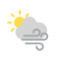


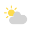


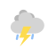
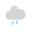
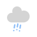
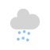

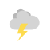


### Icones fixes blancs:


### Icones fixe blancs (variation 1):






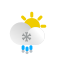


### Icones fixes blancs agrandis (variation 2):


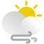





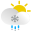


Les icônes fixe viennent de https://icon-icons.com/fr/pack/The-Weather-is-Nice-Today/1370, création de Laura Reen. J'ai parfois apporté de légère modifications. Le jeu `icons_5` reprend `icons_4`, agrandi en 2026 ; il n'avait pas `cloudy-night-3`, `rainy-6` ni `windy-night` : ces trois-là ont été agrandies comme leurs voisines (`cloudy-day-3`, `rainy-5`, `cloudy-night-2`), avec l'aide d'une IA.
Les icônes animés bleus sont issus de https://www.amcharts.com/free-animated-svg-weather-icons/, avec modifications sur certain pour les compléter.
Les icônes animés blancs arrivent de https://github.com/fineemb/lovelace-colorfulclouds-weather-card, avec modifications de positionnement.
